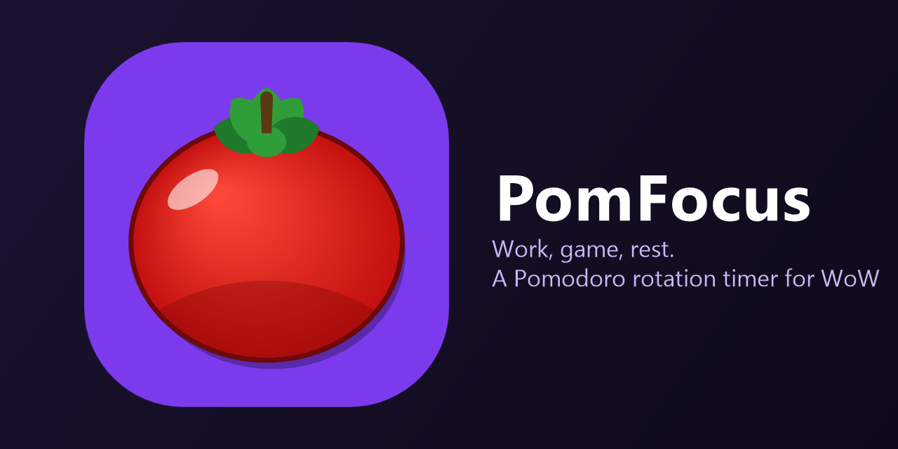

# PomFocus

A World of Warcraft (WoW: Forever / Mainline, Interface 16001) addon: a Pomodoro-style rotation timer with editable timers, combined minute / quest / task goals, and a flashing visual alarm.

## Features
- **Minimap tomato button** - click to open setup, drag to move it around the minimap.
- **Custom timers** - each has Minutes, Quests and Tasks goals; it ends when *any* goal is hit first (e.g. 25 min or 5 quests). Leave a goal at 0 to ignore it.
- **Rotation** - an editable, looping list of named steps (default: Work / chores, Game time, Work / chores, Rest). The alarm offers a one-click button to start the next step.
- **Quest tracking** - counts quests turned in automatically; tasks (home / work / office) use the **+1 task** button or `/pf done`.
- **Visual alarm** - pulsing banner, full-screen flash, repeating sound and taskbar flash.

## Install
Copy the `PomFocus` folder into `<WoW>\_forever_\Interface\AddOns\` and `/reload`.

## Commands
`/pf` (also `/pomfocus`, `/ft`, `/pomodoro`)
- `/pf` - open / close setup
- `/pf start <min> [quests] [tasks]` - e.g. `/pf start 25 5`
- `/pf rotation | skip | done | pause | resume | stop | status | test | reset`

(`/focus` is a built-in WoW command, so it isn't used.)
